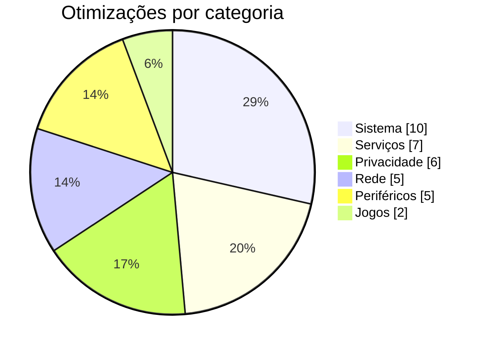

# ⚡ Tutu's Optimizer

<p align="center">
  <strong>Desempenho real, ajustes avançados e mais controle para o seu PC.</strong><br/>
  Compatível com Windows 10 e 11.
</p>

<p align="center">
  
  
  
</p>

<p align="center">
  <b>35 otimizações</b> • <b>49 jogos</b> • <b>34 ajustes reversíveis</b> • <b>Modo claro e escuro</b>
</p>

<p align="center">
  <a href="https://github.com/arthurcavalcante/Tutu-Optimizer">
    
  </a>
</p>

> O card acima é gerado por uma API pública. Os gráficos abaixo usam Mermaid, renderizado pelo GitHub; não há arquivos de imagem no repositório.

## Sobre

O **Tutu's Optimizer** é um aplicativo local para centralizar ajustes, manutenção e monitoramento do Windows em uma interface gráfica. Permite escolher otimizações por categoria, acompanhar a execução por logs e reverter os ajustes compatíveis.

### O que oferece

- 35 ajustes para sistema, privacidade, rede, jogos, periféricos e serviços;
- otimização rápida e seleção individual de ajustes;
- ferramentas de manutenção, incluindo limpeza de temporários e reparo do Windows;
- monitoramento de CPU, GPU, memória e armazenamento, conforme os dados expostos pelo hardware;
- catálogo de 49 jogos e suporte a executáveis personalizados;
- criação de ponto de restauração, logs e reversão de 34 ajustes;
- interface em modo claro ou escuro.

### Distribuição dos ajustes



## Requisitos

- Windows 10 ou Windows 11 (64-bit recomendado);
- privilégios de Administrador;
- PowerShell e WMI para determinados recursos;
- `nvidia-smi` é opcional e usado para obter alguns dados de placas NVIDIA.

## Baixar e executar

1. Acesse [Releases](https://github.com/arthurcavalcante/Tutu-Optimizer/releases) e baixe a versão mais recente.
2. Extraia os arquivos, se necessário, e abra `Tutu's Optimizer.exe`.
3. Aceite a solicitação do UAC.
4. Revise os ajustes e crie um ponto de restauração antes de aplicá-los.

### Compilar o projeto

```powershell
git clone https://github.com/arthurcavalcante/Tutu-Optimizer.git
cd Tutu-Optimizer
powershell -ExecutionPolicy Bypass -File .uild.ps1
```

O script de compilação usa o `csc.exe` do .NET Framework instalado no Windows.

## Uso recomendado

1. Abra o aplicativo como Administrador.
2. Confira as informações do sistema e leia a descrição de cada ajuste.
3. Crie um ponto de restauração.
4. Selecione apenas as opções adequadas ao seu uso.
5. Aplique e confira o resultado no painel de logs. Reinicie o Windows quando necessário.

> [!WARNING]
> O aplicativo altera configurações do Windows. Alguns ajustes podem afetar recursos de que você depende, como impressoras, pesquisa, Hyper-V ou serviços do Xbox. Leia cada descrição antes de aplicar e teste o sistema depois.

## Desempenho

Os resultados variam conforme o hardware, os drivers, a versão do Windows e os programas utilizados. O projeto não promete aumento fixo de FPS nem redução de ping. Benchmarks devem informar a configuração testada e medições reproduzíveis.

## Tecnologias

C# • Windows Forms • .NET Framework • PowerShell • WMI • Windows Registry • Win32 API

## Contribuir e reportar problemas

Contribuições são bem-vindas. Para relatar um problema, abra uma [issue](https://github.com/arthurcavalcante/Tutu-Optimizer/issues) e inclua, se possível:

- versão do Windows e do Tutu's Optimizer;
- CPU, GPU e RAM;
- ação realizada e resultado esperado/obtido;
- log relevante.

## Licença e autor

Distribuído sob a licença [Apache-2.0](LICENSE).

Desenvolvido com ❤️ por [Arthur Cavalcante](https://github.com/arthurcavalcante).

Foi feito o uso de IA para desenvolvimento do código, mas o código base foi feito totalmente a mão!
